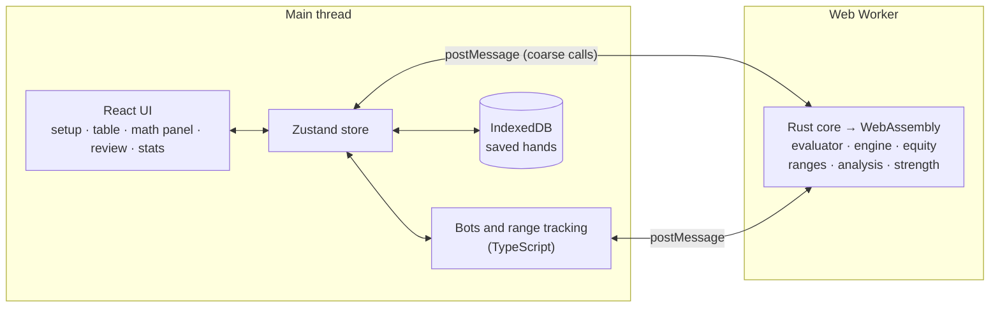

# Poker Trainer

**Try it live: [poker-trainer-3xz.pages.dev](https://poker-trainer-3xz.pages.dev)** (no sign-up; hands are saved only in your browser).

A browser-based No-Limit Hold'em trainer: play against bots and see the math behind every decision, live. The hand evaluator, game engine, equity engine and decision analysis are written in Rust, compiled to WebAssembly, and run in a Web Worker; the interface is React and TypeScript.

At every decision the math panel shows your equity against the opponent's estimated range, pot odds, MDF, SPR, implied odds, outs (clean and dirty), and the estimated EV of each option, with a plain-language explanation. After each hand you can replay it and see which decisions lost EV.

## Features

- **Table setup**: heads-up or 6-max, 20–250 BB stacks, four bot styles (balanced reg, loose-aggressive, tight-passive, calling station), and presets such as "6-max, 100 BB, mixed opponents".
- **Play view**: a full table with an action bar (fold, check/call, bet/raise with a size slider and presets). Keyboard shortcuts: F fold, C check/call, R bet/raise, A all-in, N next hand.
- **Math panel**: equity with a confidence interval when sampled, equity needed, MDF, SPR, implied odds, outs with Rule of 2/4 next to the exact odds, EV of every option, and a 13×13 range grid adjusted for blockers. You can edit the range, and the numbers update.
- **Coach modes**: always on; after you act (commit first, then see the numbers); or off, for test mode.
- **Opponent ranges** narrow with each action (Bayesian updating), using the same model the bots play with. When you don't tell the coach a bot's style, it assumes an average opponent.
- **Hand review**: every hand is saved on your device (IndexedDB). You can replay any hand street by street, with each decision graded *fine* (under 0.25 BB lost), *marginal* (0.25–1 BB) or *mistake* (over 1 BB).
- **Stats**: mistakes per 100 hands, EV lost by kind of error (calling too wide, folding too much, sizing, missed value), and a trend across sessions.
- **Accessible**: every screen passes automated axe checks, actions and new cards are announced to screen readers, and focus moves to each new screen.

## How it works



- **Hand evaluator** (`crates/poker-core/src/eval`): cards are 0–51 and sets of cards are 64-bit masks. A 7-card hand is scored with one pass over the cards and one table lookup: a flush table indexed by the suit's 13-bit rank mask, and a minimal perfect hash over rank counts (49,205 entries). The tables are generated from a simple reference evaluator and checked against it.
- **Game engine** (`engine/`): an event-sourced state machine. A hand is a list of events (blinds, deals, actions, board cards, awards), so the same seed and events always rebuild the same state. That makes saving and replaying hands trivial. It handles minimum raises, short all-ins that don't reopen betting, and side pots with odd chips.
- **Equity** (`equity.rs`): enumerates exactly when the work fits a budget (about 2M evaluations: every river and turn, most flops); otherwise runs Monte Carlo until the standard error is under 0.5% or 80 ms have passed.
- **Decision analysis** (`analysis.rs`): every formula from the math reference. Dirty outs are found by checking each card against the opponent's range, and fold rates come from the opponent model.
- **Bots** (`web/src/bots`): each style is data — preflop ranges by position, and postflop action probabilities by hand-strength bucket. The same function drives both the bots' decisions and the range narrowing, and a test checks that a bot's real hand is never ruled out.

## Accuracy and performance

All of these numbers are measured, not assumed. Speeds are from the development laptop, plugged in.

| What | Result |
|---|---|
| Hand evaluator, all 2,598,960 five-card hands | Category counts exact; 7,462 distinct hand strengths |
| Hand evaluator, all 133,784,560 seven-card hands | Category counts exact; 4,824 distinct strengths |
| Evaluator speed (native, 7-card) | **44.7M hands/s**, against a 20M target; 61× the reference evaluator |
| Evaluator speed (WebAssembly, in browser) | **0.97–1.15× native**, against a ≤ 2× target |
| Exact equity vs [eval7](https://pypi.org/project/eval7/) on [200 spots](bench/spots/) | Largest difference **5×10⁻⁷**, against a 0.001 target |
| Monte Carlo 95% intervals containing the true value | 191 of 200 spots (95.5%) |
| Equity latency, 100 random flops in browser (p95) | **4.3 ms**, against a 100 ms target |
| Full math panel in browser (p95, 6-max): preflop / flop / turn / river | 80 / 71 / 22 / 30 ms |
| Game engine property tests | 100,000 random hands: chips conserved, every pot awarded, replays identical |

The 200-spot benchmark set and the script that generated its reference values are in [`bench/spots/`](bench/spots/), so anyone can check the equity engine.

## Running it locally

You need Rust (stable) with the `wasm32-unknown-unknown` target, [wasm-pack](https://crates.io/crates/wasm-pack), Node 24, and pnpm 11.

```sh
rustup target add wasm32-unknown-unknown
cargo install wasm-pack

cd web
pnpm install
pnpm dev          # builds the WebAssembly, then serves http://localhost:5173
```

A developer page with the raw equity calculator and core speed is at `http://localhost:5173/?lab`.

## Testing

| Command | What it runs |
|---|---|
| `cargo test --workspace` | 128 Rust tests: evaluator, engine, side pots, ranges, equity, analysis |
| `cargo test --workspace --release -- --ignored` | The slow ones: all 7-card hands, 100,000 random hands, the 200-spot benchmark, Monte Carlo coverage |
| `cargo bench -p poker-core` | Criterion benchmarks (CI fails any push that makes one more than 10% slower) |
| `pnpm test` (in `web/`) | 154 TypeScript unit and component tests, including tests against the real compiled core |
| `pnpm test:e2e` (in `web/`) | Playwright in Chromium: play hands, review one, check stats, accessibility scans of every screen |

CI runs all of these on every push.


## Project layout

```
crates/poker-core/   Rust: cards, evaluator, engine, ranges, equity, analysis, strength
crates/poker-wasm/   wasm-bindgen API for the browser (thin; converts types)
web/src/ui/          React screens: setup, play view, math panel, review, stats
web/src/bots/        Bot profiles, opponent model, range tracking, fold curves
web/src/state/       Zustand store: hand flow, bots, analysis, grading, saving
web/src/storage/     IndexedDB (Dexie): sessions, hands, decisions
web/src/explain/     Template explanations and formatting
web/e2e/             Playwright end-to-end tests
bench/spots/         200-spot equity benchmark with eval7 reference values
fixtures/            Formula test cases shared by the Rust and TypeScript tests
```


