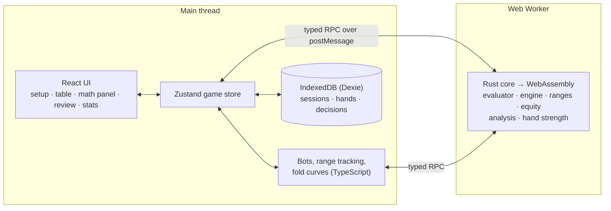

# Poker Trainer: Project Documentation

This document covers the whole project: what it is, how it's built, and what was done in each phase, including the problems found along the way and how they were solved. For a short introduction and setup instructions, see the [README](../README.md).

**Contents**

1. [Overview](#1-overview)
2. [Tech stack](#2-tech-stack)
3. [Architecture](#3-architecture)
4. [Repository layout](#4-repository-layout)
5. [Phase-by-phase history](#5-phase-by-phase-history)
6. [Testing strategy](#6-testing-strategy)
7. [Accuracy and performance results](#7-accuracy-and-performance-results)
8. [Continuous integration](#8-continuous-integration)
9. [Changes from the original plan](#9-changes-from-the-original-plan)
10. [Known limitations and future work](#10-known-limitations-and-future-work)

---

## 1. Overview

### What it is

A browser-based **No-Limit Hold'em trainer**. You play hands against bots, and at every decision a math panel shows the numbers behind it:

- equity against the opponent's estimated range;
- pot odds, MDF, SPR and implied odds;
- outs, split into clean and dirty;
- the estimated EV of each option;
- a plain-language explanation of the best play.

After each hand you can replay it street by street and see which of your decisions lost expected value, and a stats screen tracks whether your mistakes per 100 hands are falling.

### Who it's for

- **Primary:** recreational and improving players who know the rules but not the math.
- **Secondary:** recruiters and interviewers. The project is meant to show systems work, performance engineering, and product polish.

### Goals

| Goal | Status |
|---|---|
| Show every key metric at each decision, correctly, in under 100 ms | Done. Equity p95 4.3 ms; full math panel p95 under 100 ms on every street. |
| Teach, not just calculate: every number comes with an explanation | Done. Template explanations and a verdict on each decision. |
| Review each hand and flag decisions that lost EV | Done. Replay, per-decision grade, and EV lost. |
| Measure whether decisions improve over sessions | Done locally: a mistakes-per-100-hands trend by session. Counting users across devices was deferred. |

### Non-goals

- Real-money play, or anything that runs alongside real-money sites.
- Game-theory-optimal solving (a stretch goal).
- Human-vs-human multiplayer.
- Variants other than No-Limit Hold'em cash games.

### Screens

1. **Table setup:** table size, stack depth, bot styles and presets, coach mode.
2. **Play view:** the table, action bar and math panel side by side.
3. **Hand review:** saved hands, a replay, and graded decisions.
4. **Stats:** session and lifetime numbers, EV lost by kind of error, and a trend across sessions.

---

## 2. Tech stack

| Layer | Choice | Why |
|---|---|---|
| Core engine | **Rust** (edition 2024), compiled with **wasm-bindgen** and **wasm-pack** | Speed and memory control; one tested source of truth for all rules and math |
| Randomness | `rand_chacha` (ChaCha20 / ChaCha8) | Seeded and value-stable, so a saved seed replays the same deck forever |
| Timing in WebAssembly | `web-time` | `std::time::Instant` crashes in the browser; this uses `performance.now()` there instead |
| Frontend | **React 19**, **TypeScript 6**, **Vite 8** | Fast iteration, and strong typing at the WebAssembly boundary |
| UI state | **Zustand 5** | Small and simple for game state |
| Local storage | **IndexedDB** via **Dexie 4** | Stores thousands of hands in the browser |
| Off-main-thread work | **Web Worker** with a hand-rolled typed RPC | Keeps the table smooth while equity computes |
| Rust tests | `cargo test`, **proptest**, **Criterion** | Unit, property-based and benchmark tests |
| Web tests | **Vitest** (+ jsdom, Testing Library, fake-indexeddb), **Playwright** with **axe-core** | Unit, component, end-to-end and accessibility tests |
| Linting | `rustfmt`, `clippy -D warnings`, **oxlint** | Every warning fails CI |
| CI | **GitHub Actions** | Tests, benchmarks with a regression gate, a build artifact, end-to-end tests |
| Hosting | Static (Cloudflare Pages, Vercel, Netlify…) | No server needed; deployment deferred for now |
| Package manager | **pnpm 11** | Pinned in `package.json` for CI |

The equity reference values come from **eval7** (Python), an independent open-source poker library, used offline only.

---

## 3. Architecture



### Key design decisions

1. **All rules and math live in one Rust core.**
   - The evaluator, game engine, side pots, ranges, equity, decision analysis and hand strength are all in `poker-core`.
   - TypeScript handles only presentation, bots, explanations and storage.
   - So there's exactly one tested implementation of anything that decides who wins or what a number is.
2. **Event sourcing.** A hand is a list of events (blinds, deals, actions, board cards, awards).
   - The engine's only mutation is `apply_event`, so the same events always rebuild the same state.
   - Saving a hand means saving its config, seed and events.
   - Replay and review need no extra machinery.
3. **The WebAssembly side is stateless.**
   - The UI keeps each hand as plain data.
   - Every call sends config, seed and events, and the worker replays them (microseconds) before acting.
   - Nothing on the main thread points into WebAssembly memory, and a worker restart loses nothing.
4. **Coarse calls across the boundary.**
   - A few calls carry large payloads; for example, a range crosses as one flat 1,326-weight array.
   - Each JavaScript↔WebAssembly crossing has a cost, so fewer is better.
5. **One opponent model, used two ways.**
   - The same `rawProbs` function decides how bots play and narrows their estimated ranges (Bayesian updating).
   - So the coach's picture of an opponent always matches how that opponent actually plays.
   - The same model also produces the fold rates in the EV calculations.
6. **The core is injected into the store.** `createGameStore({ core })` takes the core as a parameter.
   - The app passes the Web Worker client.
   - Tests pass the real compiled WebAssembly, loaded directly in Node, with zero bot delay.
   - So the full game flow is tested against the real engine without a browser.

---

## 4. Repository layout

```
crates/poker-core/          Rust core (no browser code)
  src/card.rs, mask.rs        Cards (0–51) and 64-bit card sets
  src/eval/                   naive.rs (reference) and fast.rs (lookup tables)
  src/engine/                 hand.rs (state machine), pots.rs (side pots), deck.rs
  src/range.rs                1,326-weight ranges, notation parser/printer
  src/equity.rs               Exact and Monte Carlo equity, per-combo breakdown, cache
  src/math.rs                 The plan's formulas
  src/analysis.rs             Decision analysis (DecisionAnalysis)
  src/strength.rs             Hand-strength percentile for all combos
  tests/                      Property tests, 200-spot benchmark, shared formula fixtures
  benches/                    Criterion: evaluator, equity, analysis
crates/poker-wasm/          wasm-bindgen API: dto.rs (types and conversions), lib.rs
web/                        React app
  src/core/                   Shared types, cards, combos, 13×13 grid
  src/math/                   TypeScript formulas (the Phase 0 prototype, still tested)
  src/worker/                 Web Worker, protocol (CoreApi), RPC client, api.ts
  src/bots/                   Profiles, opponent model, bot decisions, range tracker, fold curves
  src/state/                  Zustand store, session settings and presets
  src/storage/                Dexie database and repository
  src/explain/                Explanations, event descriptions, formatting
  src/review/                 Grading, replay steps, stats
  src/ui/                     Screens and components (setup, play, math panel, review, stats)
  src/dev/                    Developer page (?lab)
  e2e/                        Playwright end-to-end tests
bench/spots/                200 equity spots, eval7 reference script, results
fixtures/formulas.json      Formula test cases shared by Rust and TypeScript
scripts/bench_gate.py       Fails CI on a >10% benchmark slowdown
.github/workflows/ci.yml    CI pipeline
```

---

## 5. Phase-by-phase history

The plan had ten phases (0–9). They were done in order, except that **Phase 5 (WebAssembly and the Web Worker) came before Phase 4 (decision analysis)**, so the app could run in a browser sooner. Each phase ended with an exit check from the plan.

### Phase 0: Scaffolding and the TypeScript math prototype

**Goal:** a project that builds and tests in CI, plus every formula from the math reference working in TypeScript.

**What was built**
- A Cargo workspace with two crates. **`poker-core`** is pure Rust, testable natively. **`poker-wasm`** is a thin binding crate (`crate-type = ["cdylib", "rlib"]`), so browser code never leaks into the core.
- A Vite + React + TypeScript app in `web/`, with Vitest and TypeScript **strict mode** enabled.
- Shared types in `web/src/core/types.ts` (`Card`, `Action`, `HandEvent`, `DecisionAnalysis`…), written as discriminated unions. `erasableSyntaxOnly` rules out `enum`, so string unions are used instead.
- `web/src/math/formulas.ts`: pot odds, EV of calling and betting, bluff break-even, MDF, implied odds, n-choose-k, outs, SPR and combo counts. These are tested against every worked example in the plan.
- A private GitHub repository and a first CI workflow (a Rust job and a web job).

**Problems found and fixed**
- **Five formulas were wrong in the first draft:**
  - EV of calling forgot the (1 − E) factor;
  - EV of betting used P + B instead of P + 2B;
  - MDF was a copy of bluff break-even;
  - implied odds was rearranged incorrectly;
  - two-card outs used 46/45 unseen cards instead of 47/46.
- **The combo formula couldn't describe unpaired hands with one count,** so it was split into `pairCombos` and `unpairedCombos`.
- **Environment:** Rust on Windows needed the Visual Studio C++ Build Tools for its linker (`link.exe`), and VS Code had to be restarted to pick up the new PATH.

**Exit check:** CI green, and every worked example passes.

### Phase 1: Cards and the hand evaluator

**Goal:** score any 5–7 cards as one comparable number, first correctly, then fast (target 20M+ hands per second).

**What was built**
- **`card.rs`:** a `Card(u8)` newtype encoded as `rank * 4 + suit`, so rank is `c >> 2` and suit is `c & 3`. It parses and prints text like `"As"`.
- **`mask.rs`:** `CardMask(u64)`, with one bit per card. Conflict checks, unions and counts are single CPU instructions.
- **`eval/naive.rs`:** the simple reference evaluator.
  - It counts ranks, detects flushes and straights (the wheel A-2-3-4-5 counts as five-high), and orders ranks by group size for tie-breaks.
  - It packs the result into a `HandRank` `u32`: the category goes in bits 20–23, then up to five 4-bit ranks.
  - For 7 cards it takes the best of the 21 five-card subsets.
- **`eval/fast.rs`:** one pass over the cards, then one table lookup.
  - **Flushes:** a 5-card flush in 7 cards rules out quads and full houses, so the suit's 13-bit rank mask indexes an 8,192-entry table directly.
  - **Everything else** depends only on the 13 rank counts. These are numbered by a **minimal perfect hash**: 6,175 / 18,395 / 49,205 entries for 5 / 6 / 7 cards.
  - **The tables are generated once** (about 59 ms) by running the reference evaluator, so every value comes from verified code.
- A Criterion benchmark.

**Tests**
- All **2,598,960** five-card hands give the exact category counts (40 straight flushes, 624 quads… 1,302,540 high cards) and exactly **7,462** distinct strengths.
- The fast evaluator matches the reference on every 5-card hand, on random 6- and 7-card hands, and on 1M random 7-card hands.
- All **133,784,560** seven-card hands give the exact counts and **4,824** distinct strengths. This runs in release mode in CI.

**Result:** **44.7M** seven-card evaluations per second natively, 61× the reference evaluator.

### Phase 2: The game engine

**Goal:** a correct No-Limit Hold'em state machine, including the riskiest part, side pots.

**What was built**
- **`engine/deck.rs`:**
  - A ChaCha20-seeded Fisher–Yates shuffle, with rejection sampling to avoid modulo bias.
  - A test pins seed 0's first five cards, so any change to the shuffle (which would break saved hands) fails loudly.
  - Stacked decks, for setting up specific spots.
- **`engine/pots.rs`:**
  - Pots are built from contribution levels, and adjacent levels with the same eligible players are merged.
  - An uncalled excess returns to its owner.
  - When a pot is split, odd chips go one at a time starting left of the button.
- **`engine/hand.rs`:** `HandState` with `apply_event` as the only mutation.
  - **Whose turn it is is derived, never stored:** a player needs to act if they owe chips, or haven't acted this street and someone else could still respond.
  - **Legal actions:** the minimum raise is the last full raise.
  - **Short all-ins** don't reopen betting, except that several short all-ins adding up to a full raise do (the tournament-rules refinement).
  - **No raising when nobody can respond.**
  - Next streets, board run-outs and awards are recorded automatically.
- **Replay** validates every event, so a corrupted saved hand is rejected.

**Tests**
- 40 hand-written scenarios: positions, minimum raises, short all-ins, side pots, ties, odd chips and replay.
- **Property tests** (proptest) over random tables, stacks and legal actions, checking chip conservation, valid board sizes, no duplicate cards, every pot awarded, and replay equal to live play.
  - 1,000 hands run on every test run, and **100,000** in release mode.
  - A coverage check confirms random play reaches showdowns, multi-way side pots and split pots.

**Problems found and fixed**
- **A winner was asked to act mid-payout.** Paying an all-in player gave them chips again. Fixed: once awards start, nobody acts.
- **Found by the property tests:** a folded player was paid. A short all-in big blind made the small blind "owe" a phantom call.
  - **Rule fix:** the full blind must still be called while someone else can act, but a lone player who already covers everyone owes nothing.
  - Proptest saved the minimal failing case as a permanent regression.

### Phase 3: Ranges and the equity engine

**Goal:** fast, accurate equity against weighted ranges, verified against an established calculator.

**What was built**
- **`range.rs`:** a range is 1,326 weights, one per combo, with combo index `h·(h−1)/2 + l`.
  - **PokerStove-style notation:** `22+`, `A2s+`, `KTo+`, `AKs-ATs`, `TT-77`, `AsKd`, and weights written as `AKs:0.5`, `0.5(…)` or `50%(…)`.
  - **A canonical printer:** printing then parsing gives back exactly the same range, tested on 500 random ranges.
  - Blocker removal and a stable fingerprint.
- **`equity.rs`:**
  - **Choosing a method:** estimate the work first. At most 2M evaluations means exact enumeration; otherwise Monte Carlo until the standard error is under 0.5% or 80 ms have passed.
  - **Multiway is Monte Carlo,** redealing the whole hand on any card collision, which keeps the joint odds correct.
  - A FIFO result cache.
- **The 200-spot benchmark** (`bench/spots/`), with reference values from eval7.
- **A CI benchmark regression gate** (`scripts/bench_gate.py`).

**Problems found and fixed**
- **eval7's "exact" function only handles complete boards and ignores weights.** The reference script uses eval7's parser, its evaluator, and its per-board exact function, and adds the turn/river enumeration and the weighting itself.
- **Rust's clock crashes in WebAssembly.** Switched to `web-time`.
- **The bench gate needed three fixes over time:**
  1. `cargo bench` also ran the library's tests in bench mode, which reject Criterion's options. The library is now `bench = false`, and old commits' benchmarks are named explicitly.
  2. The old and new commits shared one build folder, so cargo reused the old build because its files looked newer. The old commit now builds in its own folder.
  3. Shared CI machines are noisy, so the gate compares old and new on the same machine, and fails only when the **whole** 95% confidence interval is above +10%.

**Results:** exact equity matches eval7 on all 200 spots, with the largest difference **5×10⁻⁷**. Monte Carlo's 95% intervals contained the truth in **191/200** spots.

### Phase 5: WebAssembly and the Web Worker (done before Phase 4)

**Goal:** run the core in the browser, off the main thread, within the latency targets.

**What was built**
- **`poker-wasm`:**
  - **`dto.rs`** has serde types shaped exactly like the TypeScript types (`{ kind: "raise", to }`, `{ t: "award", potIndex, … }`), with conversions. They're tested natively with JSON.
  - **`lib.rs`** exports `warmUp`, `newHand`, `applyAction`, `viewHand`, `evaluate`, `equity`, `parseRange`, `rangeToNotation` and `evalThroughput`. Later phases added `analyze` and `comboStrengths`.
  - Missing values serialize as `null`, not `undefined`, matching the TypeScript `T | null`.
- **Worker and client:**
  - **`protocol.ts`** defines one `CoreApi` interface.
  - **`core.worker.ts`** loads the WebAssembly and answers `{ id, method, args }` messages.
  - **`coreClient.ts`** turns each method into a Promise matched by message id, and fails every pending call if the worker dies.
- **A developer page:** an equity lab, a latency test, and a hand you play for every seat.
- **Boundary tests** that load the real `.wasm` in Node, plus separate TypeScript configs for app code and test code.

**Problems found and fixed**
- **The first WebAssembly speed reading said 3.3× slower than native,** which would have failed the target. Browsers first run WebAssembly with a quick baseline compiler and optimize it shortly after. Measured across five fresh browsers, the optimized code runs at 0.97–1.15× native, so no SIMD or LTO work was needed.
- **The global `npm` on the development machine was broken** (a stale nvm install). The project uses pnpm only.

**Results:** WebAssembly at **0.97–1.15× native**, and **p95 equity latency 4.3 ms** in the browser.

### Phase 4: Decision analysis

**Goal:** compute every number the math panel needs, in Rust.

**What was built**
- **`math.rs`:** the formulas, mirroring the TypeScript versions. Both are tested against **one shared file**, `fixtures/formulas.json` (27 cases), so they can't drift apart.
- **`equity_by_combo`:** hero's equity against each combo in a range. It comes from the same exact pass, or from a per-combo sample when the spot is too big.
- **`analysis.rs`, `analyze(hand, hero, ranges)`, returns:**
  - pot, amount to call, effective stack, equity, pot odds, MDF (P−C into P), SPR, and implied odds needed (clamped at zero);
  - **outs:** each unseen card is checked against the range. It's an out if it takes hero from behind most of the range to ahead of most of it, and **dirty** if at least 20% of the range still wins;
  - the Rule of 2/4 against the exact odds;
  - **EV of each action:** fold, check/call, bets/raises at ⅓, ½, ¾ and 1× the pot after calling, all-in, and any extra size requested.
- **The EV models,** all "this street, then showdown":
  - check = E·P;
  - call = E·P − (1−E)·C, adjusted when hero is all-in for less;
  - bet/raise = f·P + (1−f)·(E_called·pot_if_called − hero_in).
  - The **calling range** is the strongest part of the opponent's range: the combos hero does worst against.
- `ReviewedDecision` was split from `DecisionAnalysis`, since grading belongs to the review.

**Problems found and fixed**
- **The first multiway model rated a 33× pot shove at +103 chips:** it assumed callers hold their *average* hand. Fixed with calling-range narrowing for multiway too (refined in Phase 6), plus a regression test confirmed to fail on the old model.

**Results (native):** a full analysis takes about 3 ms facing a flop bet, and about 11 ms preflop.

### Phase 6: Bots and Bayesian range narrowing

**Goal:** four bot styles, and range estimates that match how the bots actually play.

**What was built**
- **Additions to the core:**
  - the engine now reports **raises this street**, so bots can tell an open from a 3-bet;
  - **`strength.rs`** scores every combo's hand-strength percentile on a board, averaged over the next card so draws get partial credit. All 1,326 combos take about 2 ms;
  - the analysis takes **fold curves** (fold rate by price, per opponent) in place of Phase 4's placeholder.
- **TypeScript bots (`web/src/bots`):**
  - **Profiles:** balanced reg, loose-aggressive, tight-passive and calling station, as data. Preflop ranges by position (open, big-blind option, vs a raise, vs a 3-bet); postflop probabilities over five strength buckets (air, weak, medium, strong, nuts).
  - **`model.ts`:** the single `rawProbs` function, a legality adjustment (no folding when checking is free, no raising when not allowed), and a population average for unknown styles.
  - **`bot.ts`:** the decision is sampled with a seeded RNG (FNV-1a hash plus mulberry32) keyed by seed, position in the hand and seat, so replays are identical.
  - **`tracker.ts`:** after each action, every combo's weight is multiplied by that action's probability, with a 2% minimum and rescaled to a maximum of 1.
  - **`foldCurve.ts`:** fold rate against each price for an opponent's current range.
- **`api.ts`** became one function table shared by the worker and the tests.

**Tests**
- 120 complete six-handed bot hands, using only legal actions.
- Identical replays from the same seed.
- **Consistency:** tracked with its own profile and no minimum weight, a bot's real hand is never ruled out.
- The styles behave as described.
- An open raise narrows to exactly the raising range.

**Problems found and fixed**
- **The full math panel took 282 ms preflop** in multiway pots. Per-opponent breakdowns got smaller budgets, bringing p95 under 100 ms on every street.
- **"Equity if called: 0.4%"** came from assuming every opponent calls with their strongest hands. Replaced by **one caller, the toughest**.

### Phase 7: The trainer UI

**Goal:** a user can play complete hands against bots with the live math panel.

**What was built**
- **The Zustand store** (`createGameStore`):
  - the hand flow and the bot loop;
  - analysis on the player's turn, ready by the time they act;
  - grading of each decision, re-analysing custom bet sizes exactly;
  - coach modes and range edits.
- **Session settings and five presets.** Stacks are topped up every hand.
- **Logic:**
  - **`grid.ts`:** the 13×13 grid, with blocker-adjusted summaries and click-to-cycle weights;
  - **`grade.ts`:** fine below 0.25 BB lost, marginal from 0.25 to 1 BB, mistake above 1 BB, each tagged with a category;
  - **`explain.ts`:** template explanations. It reproduces the plan's example sentence word for word.
- **Components:**
  - **TableSetup**;
  - **PlayView** and **Table** (an oval felt, seats, positions, bets, showdowns);
  - **ActionBar** (presets, slider, keyboard shortcuts);
  - **MathPanel**;
  - **RangeGrid** (editable);
  - **CoachPanel** (always / after acting / off).
- **Component tests in jsdom,** and a test of the full app playing real hands.

**Problems found and fixed**
- **The coach recommended absurd shoves** (95 BB into 6 BB), because bots measured bet size by pot odds, which flatten out near 50%.
  - Bot folding is now based on **bet-to-pot ratio**, with the continuing share shrinking roughly with the square root of the size.
  - The nuts never fold, and strong hands react half as much.
- **Heads-up, feedback vanished** because the next decision replaced it immediately. A "last decision" verdict now stays on screen.
- **Smaller fixes:**
  - stylesheet clashes between the developer page and the app;
  - the test helper's file path under jsdom;
  - stale bet chips after a hand ended.

### Phase 8: Saved hands, hand review and stats

**Goal:** save every hand, review it, and show progress.

**What was built**
- **Dexie database:** `sessions`, `hands` (the full `HandHistory`) and `decisions` (flat rows for stats).
  - A hand and its decisions are saved in one transaction.
  - **Ranges aren't stored** (about 32 KB per decision); the review rebuilds them from the events.
- **The store saves each finished hand automatically.** If storage is blocked, it warns and play continues.
- **The review screen:**
  - a hand list (position, cards, board, result, grade counts);
  - a replay you step through with buttons or arrow keys;
  - per-decision detail: the full math panel with the grade, and each opponent's range rebuilt as it was then.
- **The stats screen:**
  - stat tiles: hands played, mistakes per 100, EV lost per 100, and decisions graded;
  - a bar chart of EV lost by kind of error;
  - a line chart of mistakes per 100 hands by session;
  - a "this session" / "all time" switch.
  - The charts follow the data-viz skill's specs. The colour is validated, and each chart has tooltips, keyboard control and a table view.
- **Tests:** the repository (fake IndexedDB), stats arithmetic, replay steps, charts, a full play → review → stats flow, and **saved hands replay identically to live play**.

**Problems found and fixed**
- **The second session's hands were silently dropped.** Hand ids restarted at 1, so they looked already saved. Hand ids are now never reused, with a regression test confirmed to fail on the old code.
- **Preflop, every raise size had the same fold rate,** which made 99 BB shoves look best. Bots' calling ranges now shrink with raise size, while re-raising hands are unaffected.
- **Smaller fixes:** a duplicated verdict in the review, and chart titles that screen readers didn't announce.

### Phase 9: Accessibility, end-to-end tests, CI and documentation

**Goal:** polish and readiness to launch. The four-colour deck was dropped at the user's request, and deployment and analytics were deferred by choice.

**What was built**
- **Playwright end-to-end tests** (`web/e2e/`), against the production build in Chromium:
  - play hands, reload (hands persist), review one, check stats;
  - keyboard shortcuts;
  - screen-reader behaviour;
  - **axe accessibility scans** of setup, play view, hand list, hand review and stats.
- **Accessibility fixes:**
  - the accent colour was darkened to `#1b62d6` for 4.5:1 contrast;
  - the table, board and seats became labelled groups;
  - a heading for the play view;
  - **live announcements** of actions and cards;
  - **focus moves to each new screen's heading.**
- **CI:** the web job uploads the built site as an artifact named **`site`**, and runs the end-to-end tests, keeping the report on failure.
- **An `onHandFinished` hook** in the store. It sends nothing by default; it's where a usage counter can plug in later.
- **The README,** with measured results and deployment instructions.

**Results:** zero axe violations on all five screens. All 4 end-to-end tests pass.

---

## 6. Testing strategy

Correctness is the product: a trainer that shows wrong numbers teaches the wrong lessons. So every layer is checked against something independent.

| Layer | Check | Source of truth |
|---|---|---|
| Evaluator | Every 5- and 7-card hand | Published category counts; the reference evaluator |
| Formulas | Worked examples, run in both languages | `fixtures/formulas.json` |
| Game engine | 100,000 random hands (property tests) + 40 scenarios | Invariants (chips conserved, every pot awarded, replay identical) |
| Side pots | Hand-written cases: 3–4 all-ins, ties, odd chips | Worked by hand |
| Ranges | Round trips, known combo counts, agreement with eval7's parser | eval7 |
| Equity (exact) | 200 spots | eval7 |
| Equity (Monte Carlo) | 95% interval coverage on the same spots | eval7 |
| Analysis | The plan's formulas, outs by hand, regression tests for model bugs | Worked examples |
| Bots and tracking | 120 bot hands, consistency, style behaviour | The model itself (a real hand is never ruled out) |
| WebAssembly boundary | The real `.wasm` in Node | The TypeScript types |
| UI | Component tests and full-app flows in jsdom | Expected behaviour |
| End to end | Playwright + axe in Chromium | Real browser, real IndexedDB |
| Performance | Criterion benchmarks with a 10% regression gate | Same-machine comparison |

**Counts:**
- 128 Rust tests, plus 5 slow tests run in release mode;
- 154 TypeScript unit and component tests;
- 4 end-to-end tests.

A practice used throughout: **when a bug was found, a test was written that fails on the old code**, and it was confirmed to fail before the fix was kept.

---

## 7. Accuracy and performance results

Measured on the development laptop, plugged in. The browser figures come from headless Chromium.

| What | Result | Target |
|---|---|---|
| Five-card hands (2,598,960) | Exact category counts; 7,462 strengths | Exact |
| Seven-card hands (133,784,560) | Exact category counts; 4,824 strengths | Exact |
| Evaluator, native | **44.7M hands/s** | 20M+ |
| Evaluator, WebAssembly | **0.97–1.15× native** | ≤ 2× |
| Exact equity vs eval7 (200 spots) | Max difference **5×10⁻⁷** | ≤ 0.001 |
| Monte Carlo 95% coverage | **191/200** (95.5%) | about 95% |
| Equity latency, browser p95 (100 flops) | **4.3 ms** | < 100 ms |
| Native equity: river / turn / flop / wide flop / preflop (20k samples) | 0.004 / 0.12 / 2.8 / 7.2 / 1.8 ms | — |
| Native analysis: flop facing a bet / preflop | about 3 / about 11 ms | — |
| Full math panel, browser p95 (6-max): preflop / flop / turn / river | 80 / 71 / 22 / 30 ms | < 100 ms |
| Game engine property tests | 100,000 hands, 0 failures | 0 failures |
| Accessibility (axe) | 0 violations on 5 screens | 0 |

---

## 8. Continuous integration

`.github/workflows/ci.yml` runs on every push to `main` and on pull requests.

| Job | Steps |
|---|---|
| **rust** | `cargo fmt --check`, `cargo clippy -D warnings`, `cargo test`, then the slow tests in release mode (all 7-card hands, 100,000 random hands, the 200-spot benchmark, Monte Carlo coverage) |
| **bench** | Benchmark the previous commit (its own build folder), benchmark this commit against it, then fail if any benchmark's whole confidence interval is more than 10% slower |
| **web** | Install Rust, wasm-pack and pnpm; build the WebAssembly; lint; unit tests; build; **upload the site artifact**; install Chromium; **end-to-end tests**; keep the report on failure |

---

## 9. Changes from the original plan

| Plan | What was done | Why |
|---|---|---|
| Phases in order 0–9 | Phase 5 before Phase 4 | To get the app running in a browser sooner |
| Award event `{ potIndex, seats[], amount }` | One event per winner: `{ potIndex, seat, amount }` | Split pots and odd chips are written out exactly |
| Seeds as strings | `u64` in Rust, a decimal string in TypeScript | JavaScript numbers can't hold every 64-bit value |
| `DecisionAnalysis` includes `chosen`, `evLost`, `label` | Split into `DecisionAnalysis` and `ReviewedDecision` | Grading belongs to the review |
| Bots bucket hands by equity vs a generic range | Hand-strength percentile averaged over the next card | Narrowing needs a score for all 1,326 combos; full equity would take seconds |
| SPR on the flop pot | SPR at the current decision | The two are the same at the start of the flop |
| Four-colour deck | Not built | The user's decision |
| Deployment | Prepared (CI artifact and instructions), not done | Deferred by the user |
| Anonymous usage counting | A no-op hook only | Deferred: no data leaves the browser |
| Evaluator tables "at build time or const" | Generated lazily at first use (about 59 ms) and warmed at worker start | Simpler; could move to `build.rs` if startup matters |

---

## 10. Known limitations and future work

### Limitations

- **EVs count one street, then a showdown,** as specified. One visible effect: preflop, a shove with a premium hand (e.g. KK) can rate above a normal raise, because the model doesn't credit the raise with value won on later streets. The app labels every EV as an estimate. A real fix needs future-street modelling in the core.
- **Ranges are only as good as the opponent model.** The grid shows the assumption, and you can edit it.
- **The bots are simple and exploitable by design.**
- **Multiway** uses Monte Carlo equity and a single toughest caller.
- **Everything stays on one device.** There are no accounts or sync.
- **CI warnings:** the GitHub Actions `@v4` versions target Node 20, which is deprecated, so they should be bumped to their newest major versions.

### Future work

1. **Deploy:** upload the `site` artifact to a static host.
2. **Make the repository public** for recruiters.
3. **Usage counting** through the `onHandFinished` hook (e.g. GoatCounter). This is needed for the "50+ users who play 100+ hands" and "mistakes per 100 fell Y%" metrics.
4. **Future-street EV,** to fix the preflop shove bias.
5. **Stretch goals from the plan:**
   - solver-backed advice;
   - importing your own hand histories;
   - an LLM "ask why" button grounded in `DecisionAnalysis`;
   - spaced-repetition drills built from your common mistakes;
   - accounts and sync through the optional backend (Node or FastAPI, and Postgres).
